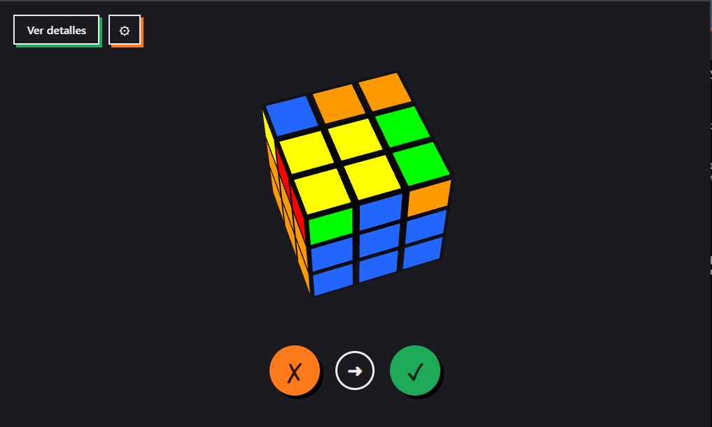
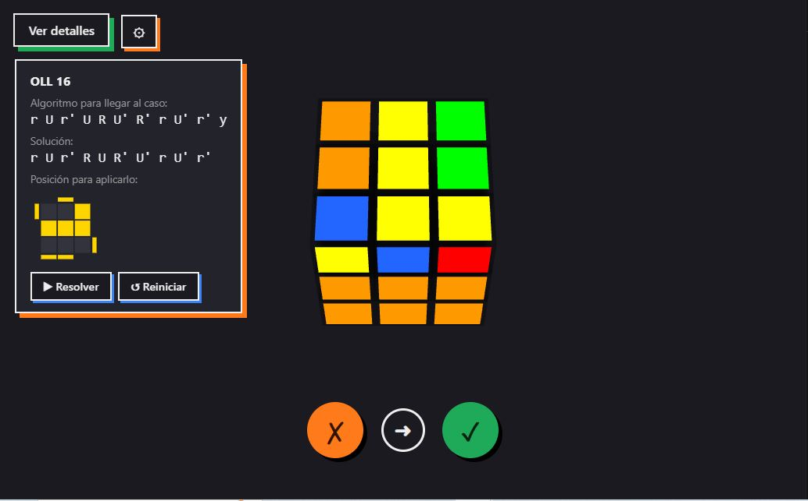
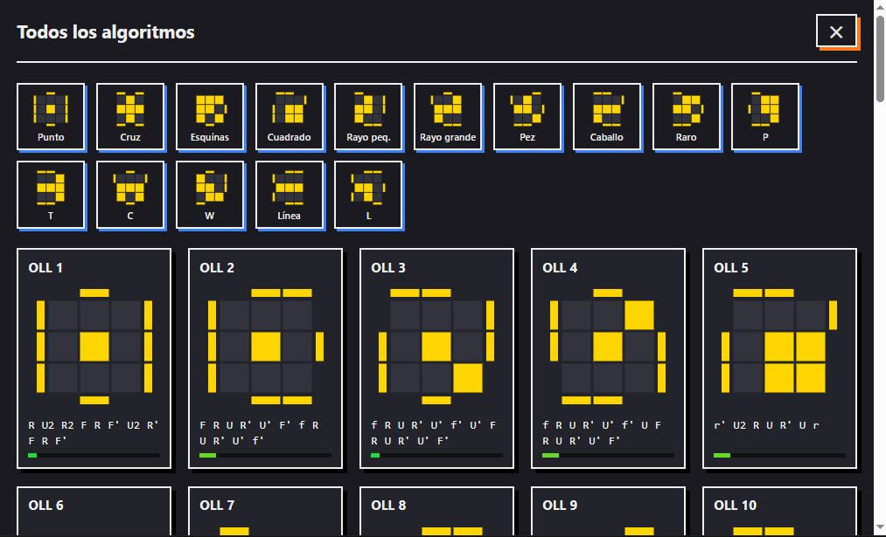
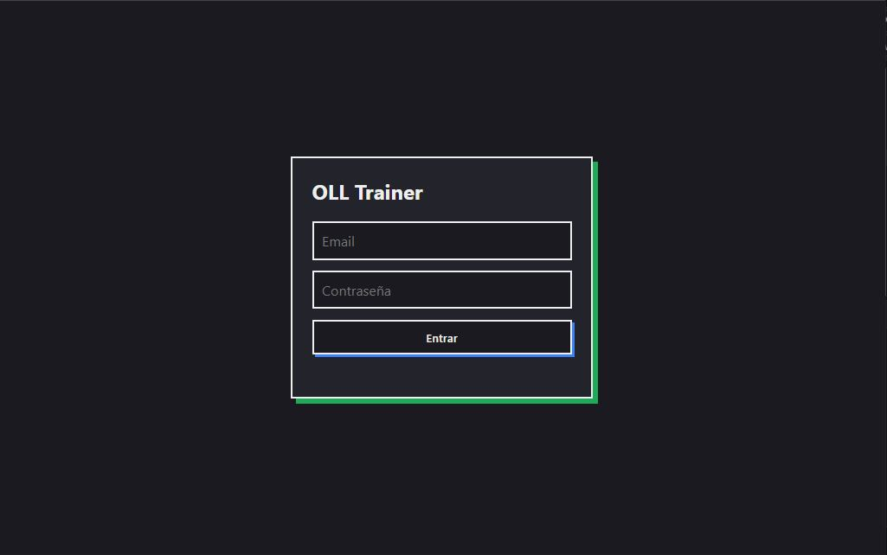

# OLL Trainer

Entrenador web para memorizar los 57 algoritmos **OLL** del cubo de Rubik (método CFOP).

## Características

- Cubo 3D con casos OLL aleatorios
- Solución, vista de la posición y animación paso a paso
- Algoritmo para llegar al caso, visible en el panel de detalles
- Marca cada caso como acertado ✓ o fallado ✗
- Barra de progreso por algoritmo
- Catálogo de los 57 casos, agrupados por forma
- Color de la capa superior configurable
- Login con usuario y contraseña (sin registro público)
- Progreso y preferencias guardados en la nube por usuario, disponibles en cualquier dispositivo

## Capturas

| Entrenamiento | Detalles y solución |
|---|---|
|  |  |

| Todos los algoritmos | Configuración |
|---|---|
|  |  |

| Inicio de sesión |
|---|
|  |

## Despliegue

Requiere una cuenta gratuita en [Supabase](https://supabase.com). Los usuarios se crean a mano (no hay registro).

1. Clona el repo y crea un proyecto en Supabase.
2. En **SQL Editor**, ejecuta el contenido de `supabase/schema.sql`.
3. En **Authentication → Sign In / Providers**, desactiva **Allow new users to sign up**.
4. En **Authentication → Users → Add user**, crea tu usuario (marca **Auto Confirm User**).
5. En **Project Settings → API Keys**, copia la Project URL y la **publishable key** (no la secret) y pégalas en `js/config.js`.
6. Sirve la carpeta con un servidor estático (no abras `index.html` con doble clic):
   ```bash
   npx serve
   ```
   O despliégala en GitHub Pages, Netlify o Cloudflare Pages.

## Tecnologías

HTML, CSS y JavaScript puro, con [cubing.js](https://js.cubing.net/cubing/) para el cubo 3D (CDN) y [Supabase](https://supabase.com) para el login y el progreso.